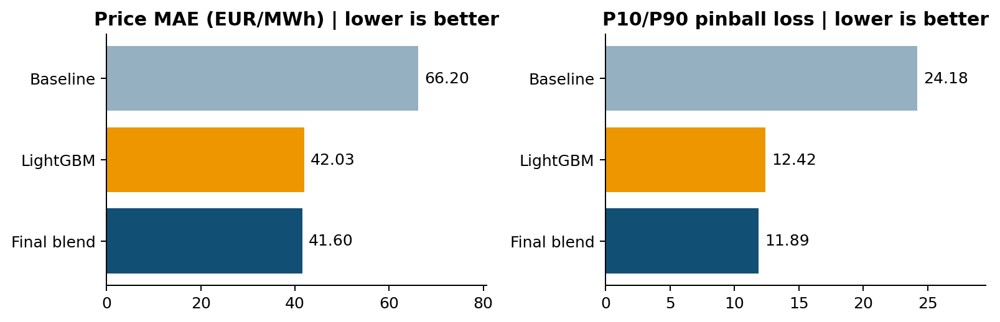
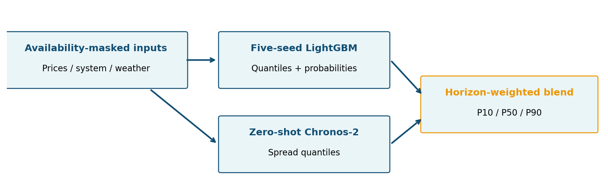
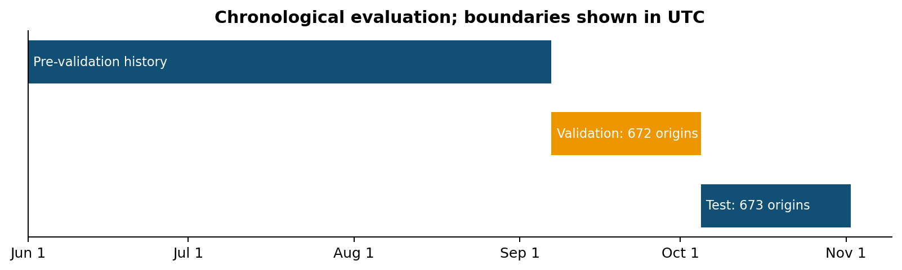
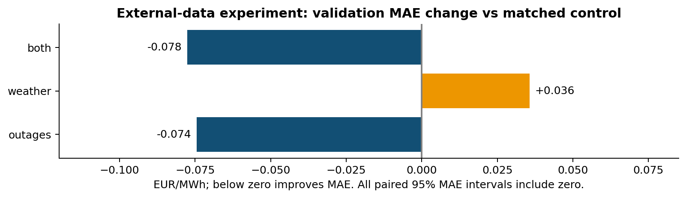
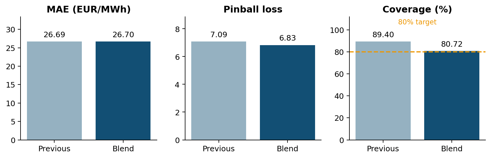

# Turku GridCast - Evaluation report

Prepared 8 November 2026. Seven-section companion to the seven-page PDF.

## 1. Evaluation report

Turku GridCast | Since AI 2026 | 8 November 2026

> A substantial validation gain over the organiser baseline; a smaller, mixed incremental gain from blending.

We forecast Finnish imbalance prices every hour for the next ten hours: 40 quarter-hours, P10/P50/P90 prices, balancing-direction probabilities and high/low spike probabilities. The final system blends five-seed LightGBM spread quantiles with zero-shot Chronos-2.

Figure 1. Same validation period and official scoring definition for all three models.

| Validation metric | Baseline | Final blend | Reduction |
| --- | --- | --- | --- |
| MAE, EUR/MWh | 66.2033 | 41.5988 | 37.17% |
| P10/P90 pinball | 24.1776 | 11.8864 | 50.84% |
| Spike Brier | 0.113176 | 0.090792 | 19.78% |
| Direction Brier | 0.450907 | 0.392898 | 12.87% |
| Interval coverage | 68.29% | 73.28% | 80% target |

Most of the baseline improvement comes from task-trained LightGBM and feature engineering. Relative to the previous LightGBM submission, the final blend improves validation MAE by 1.02% and pinball by 4.28%. These smaller gains should not be described as the full 37%/51% baseline improvement.

Scope: validation results use organiser-supplied actuals; October test results are local post-hoc scores of frozen forecasts. Official organiser test scores and competition ranking remain pending. Source: results/final_ensemble/validation_comparison.csv.

## 2. Method and reasoning

Model the imbalance spread, then restore the known delivery spot price

Figure 2. Only quantiles are blended. Direction and spike probabilities remain LightGBM-only.

### LightGBM: structured power-system information

The target is imbalance price minus spot (EUR/MWh). Cumulative feature families cover calendar/spot/history (E1), spread lags/volatility/spike history (E2), supply-demand forecasts and actuals (E3), regulation/flows/neighbour prices (E4), external Fingrid real-time measurements (EX), and ECMWF weather (EW). Selected families are direction EW, spike EX, P10 E4 and P50/P90 EX.

Each output is trained with seeds 7, 11, 23, 37 and 51; seed offsets for bagging, feature fraction and data sampling are +1/+2/+3. Average raw predictions before post-processing. Dedicated models override steps 1-4 and 5-8. Global quantiles use 250 rounds; global classifiers 400; short-horizon specialists 300. Full-precision settings are retained in lgb_completed.json.

### Chronos-2: a complementary historical representation

Zero-shot Chronos-2 uses 2,048 quarter-hours of context ending at origin minus 45 minutes. Unavailable target/covariate values are masked. It predicts 42 positions; two bridge positions are discarded, leaving the 40 required quarters. Past inputs include regulation prices/direction/activation, real-time imbalance and wind error; known-future inputs include spot and day-ahead wind, load and solar.

| Steps | Validation: LGBM / Chronos | Test: LGBM / Chronos |
| --- | --- | --- |
| 1-4 | 0.7 / 0.3 | 0.7 / 0.3 |
| 5-16 | 0.4 / 0.6 | 0.4 / 0.6 |
| 17-40 | 0.5 / 0.5 | 0.6 / 0.4 |

Weights use a 0.1 simplex grid on out-of-sample training predictions. The same weight applies to P10/P50/P90. Add delivery spot after blending spreads, sort quantiles, normalise direction probabilities and cap each spike probability by its matching direction probability. No conformal adjustment is applied to the final blend. Sources: ensemble_spec.py, ens_members.py, fm_data.py, fm_run.py and fm_blend3.py under src/pkg/.

## 3. Validation design

Chronological folds, publication-aware fitting and separate evaluation periods

Figure 3. Exact origin grids come from the starter templates, including the autumn clock change.

Training data begin 1 June 2026. The named validation days are 7 September-4 October in Finnish local time. Exact UTC validation origins run 6 September 21:00 to 4 October 20:00: 672 origins and 26,880 rows. The scorer uses 26,700 price rows; 180 horizon-tail rows have no supplied validation actuals.

The test period has 673 origins, 4 October 21:00 to 1 November 21:00 UTC inclusive, producing 26,920 rows. Step 1 starts at the origin; delivery time is origin + (step-1) x 15 minutes. There is no shuffled train/test split.

| Rolling OOS fold | Origin interval, UTC (end exclusive) |
| --- | --- |
| 1 | 5 Jul 21:00 - 19 Jul 21:00 |
| 2 | 19 Jul 21:00 - 2 Aug 21:00 |
| 3 | 2 Aug 21:00 - 16 Aug 21:00 |
| 4 | 16 Aug 21:00 - 30 Aug 21:00 |
| 5 | 30 Aug 21:00 - 6 Sep 21:00 |

Every fit uses origin < fold start and target first-usable time <= fold start. The validation fit/selection cutoff is 6 September 21:00 UTC. The final test cutoff is 4 October 21:00 UTC: validation OOS observations may then enter final training/weight selection only once their targets are usable. Test-period targets never enter fitting or selection.

Official metrics: MAE of P50; mean pinball at P10 and P90; mean high/low spike Brier at a +/-50 EUR/MWh spread threshold; and three-class direction Brier. Coverage is descriptive, with an 80% nominal target. Blend selection uses P10/P50/P90 pinball, distinct from the official P10/P90 metric.

> The stored normalized selection score S is an internal comparison objective, not official competition points. Actual points also depend on other accepted submissions and jury assessment.

## 4. Availability and leakage checks

Evidence of as-of forecasting, with explicit boundaries on what was tested

A package value is visible only when first_usable_origin_utc <= forecast origin. Composite features inherit the latest source availability. External Fingrid measurements become usable at quarter end +30 minutes, rounded up to a full hour. ECMWF runs become usable at initialization +6 hours, rounded up. The latter is an assumed conservative delay, not measured historical API ingestion.

| Check | Recorded result |
| --- | --- |
| Final CSV format | 673 origins; 26,920 rows; 0 errors, 0 warnings |
| LightGBM feature mutations | Passed at Jul 10, Sep 20 and Oct 20 cutoffs |
| LightGBM output mutations | 75 models per cutoff; 225 model checks; bit-identical |
| Chronos input mutations | 1,842 and 2,551 origins checked at two cutoffs |
| Chronos cutoff predictions | Bit-identical after unavailable-value mutation |
| Solo versus batch inference | All saved periods passed within numerical tolerance |
| Independent validation scoring | Matches saved metrics |
| Final forecast file integrity | Hashes match saved verification evidence |

### What the mutation test establishes

The tests scramble values whose first-usable time is later than a cutoff and rebuild earlier features or contexts. Outputs at checked origins stay unchanged; mutations must not influence forecasts before publication. Chronos checks cover all required input contexts through the September/October cutoffs and cutoff predictions. These are recorded test results, not a new exhaustive rerun performed for this report.

### What the checks do not establish

A format validator does not prove absence of leakage. Feature mutation tests do not audit foundation-model pretraining overlap, provider archive completeness or actual historical API arrival times. Those remain separate limitations. Repeated validation inspection also reduces the strength of claims that validation was wholly untouched.

Evidence: results/final_ensemble/feature_leak_checks.json, lgb_output_leak_checks.json, fm_leak_checks.json, fm_batch_check_*.json, lgb_training_audit.json and verification.json. The original single-model fallback is retained separately from the final candidate.

> Final file SHA-256: 297e27eafba2d4d6055f5ef28f5dffdb7afd724ea0e31418f7a2e5dd9cecd1d3

## 5. Experiments and decisions

What we tried, what we retained, and what we dropped

Figure 4. Small external-data MAE changes do not establish a reliable overall improvement.

Initial Chronos-2 benchmarks tested price, spread and covariate targets with a seven-day context. None beat the existing LightGBM on both validation MAE and official pinball. The later final Chronos configuration uses a longer context and different covariate processing; its results must not be conflated with the initial experiment.

TimesFM 3.0 and Timestral 209M were tested zero-shot on price/spread/covariate configurations. Their best local MAEs were 43.53 and 43.82, versus LightGBM 42.03. Neither model is in the final submission. No foundation-model fine-tuning was performed.

Outages and archived ICON/HARMONIE weather produced small, mixed gains. Combined features reached MAE 41.9510 versus control 42.0286, but all paired MAE intervals included zero and pre-validation fold selection retained the baseline. These additions were not adopted into the final blend.

Parameter tuning tested four feature sets with equal budgets, inherited settings plus seven random candidates per output, chronological search/confirmation, and matched calibration controls. It reduced median MAE in zero of four matched comparisons. The both_tuned result equalled its matched control on MAE; it is not evidence that tuning caused the gain over the saved submission.

Rejected or deferred: Fingrid 245 without historical forecast vintages; licensed continuous intraday prices without access; extra neighbour measurements without verified publication history; new reserve bid/capacity series without accessible as-of archives. Final-blend conformal adjustment was omitted because extra calibration hurt training-fold selection.

Sources: results/experiment_2_chronos/REPORT.md; experiment_3_foundation_models/REPORT.md; experiment_4_external_data/REPORT.md and source_audit.json; experiment_5_parameter_tuning/REPORT.md. The final blend adds a modest price/quantile gain; it does not reverse every negative experiment.

## 6. Historical test backtest

Frozen October forecasts scored locally, after model selection

Figure 5. Local test comparison: similar price error, improved pinball, coverage closer to target.

| Local test metric | Previous LightGBM | Final ensemble |
| --- | --- | --- |
| MAE, EUR/MWh | 26.690916 | 26.702820 |
| P10/P90 pinball | 7.086564 | 6.830206 |
| P10-P90 coverage | 89.40% | 80.72% |
| Spike Brier | 0.056534 | 0.056664 |
| Direction Brier | 0.394655 | 0.393744 |

The organiser actuals_test.csv was not supplied locally. Realised imbalance price and mFRR direction were reconstructed from package inputs and joined with local spot for scoring. Reconstructed labels matched every supplied validation actual before this procedure was applied to test. All 26,920 test rows were scored using score.py 0.1.1; frozen forecast hashes remained unchanged.

The blend reduces local test pinball by 3.62%, but MAE worsens by 0.0119 EUR/MWh (about 0.045%). Direction Brier improves slightly and spike Brier worsens slightly. Coverage is closer to 80%, but coverage alone is not the scored calibration objective. This is a mixed result, not an across-the-board win.

### Uncertainty in the incremental validation gain

Paired day-bootstrap analysis (5,000 resamples of 28 Finnish origin days) gives blend-minus-LightGBM MAE -0.4298 with 95% interval [-1.5052, +0.6747], and pinball -0.5309 with interval [-1.3121, +0.1546]. Both include zero. Within-day forecast overlap is retained; longer dependence and repeated validation inspection limit inference.

Do not interpret the drop from validation MAE 41.60 to test MAE 26.70 as a model upgrade: the periods and conditions differ. The official organiser may use a different locked actuals snapshot. Sources: results/final_ensemble/local_test_backtest/{README.md,comparison.csv,audit.json}; paired_day_bootstrap.csv.

## 7. Limitations and handoff

Operational prototype, reproducible evidence, and the next evaluation steps

### Limitations that materially affect the conclusion

The sample is short and season-specific; rare spikes and stressed regimes remain difficult. Validation coverage is 73.28%, below the 80% target. The ensemble improvements over LightGBM are small with broad bootstrap intervals. There is no demonstrated trading P&L, production-control benefit or competition ranking.

External publication delays are assumptions; archive completeness and model pretraining overlap are not certified. The final experiment audit verifies the requested blend and recomputes its weight grid, but does not reconstruct every upstream model-selection decision. Changes in market rules or data quality can invalidate learned relationships.

### User-facing situational view

The local dashboard provides result tables, origin replay, ten-hour quantiles, direction/spike risks, previous-hour forecast revisions, retrospective actual overlays and historical scoring windows. Publication-aware history excludes outcomes not yet usable at the selected origin. Desktop Chrome interactions and data tests passed; mobile and public deployment remain unverified.

Driver and freshness panels are explicitly labelled as references from the previous single-seed LightGBM, not explanations of the complete ensemble. Alert thresholds are illustrative expert-review prompts, not optimized trading or operating policies. Notebook execution through the IDE was blocked by kernel startup; its chart-generation cells are not claimed as execution-verified.

### Reproduction and submission

Read RUNNING.md. Start the dashboard with .venv/bin/python dashboard/server.py. Validate submission/final_ensemble/forecast_backtest.csv against forecast_origins.csv. The root forecast_backtest.csv is the older fallback. Complete_Experiment.ipynb documents all experiments and optional reruns. Retraining requires the two Python environments, private feature matrix, archived inputs and pinned Chronos checkpoint.

### Data rights and next steps

DATA_SOURCES_AND_LICENSES.md records final/research inputs, model licences, dependencies and media services. Final model members are LightGBM (MIT) and Chronos-2 (Apache-2.0); this is not a blanket licence for all assets. Nord Pool spot and private matrices must not be redistributed. TimesFM, Timestral, UMM and ElevenLabs have separate conditions.

Next: evaluate more seasons and stress events; test calibration choices only on predeclared folds; obtain verifiable intraday wind/outage vintages; validate alerts with energy experts; assess operational costs and benefits in a controlled pilot. A forecast prototype is complete enough to inspect, not proven production-ready.

> Evidence index: results/final_ensemble/REPORT.md and local_test_backtest/; experiment reports 2-5; docs/STARTER_README.md; RUNNING.md; DATA_SOURCES_AND_LICENSES.md. Charts in this report use aggregate saved metrics only. No raw spot-price data is embedded.
